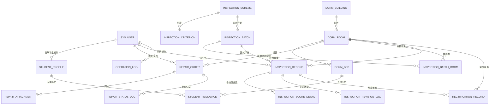
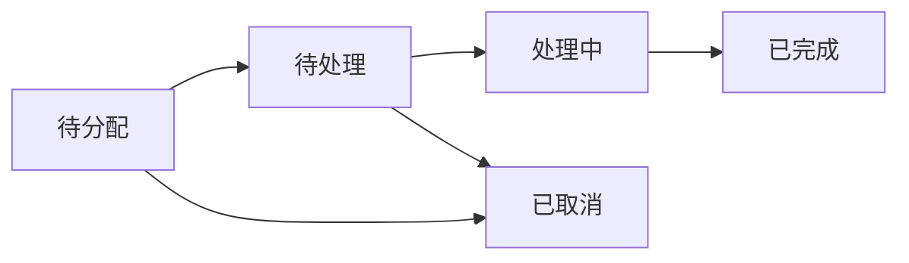

# 高校宿舍管理系统｜数据库设计与 ER 图（V1.0）

> 基准需求：PRD V1.2（2026-11-10）  
> 本阶段：逻辑数据模型与 MySQL 8 建表设计  
> 交付文件：本 Markdown + `高校宿舍管理系统_数据库设计_V1.0.sql`  
> 使用端：仅 PC Web；四类角色：系统管理员、宿舍管理员（学生会宿管部）、学生、维修人员。

## 1. 数据库设计原则

1. **身份与住宿分离**：系统用户与学生资料分别建表，住宿记录保留历史，按当前有效入住关系判断学生所在楼栋。
2. **一名宿管部成员可检查任意寝室**：`inspection_record.inspector_user_id` 指向用户，不配置“账号—楼栋”限制；每周可录入多间寝室。
3. **每周唯一正式成绩**：每个 ISO 年周一个检查批次，`(batch_id, room_id)` 唯一，阻止同周重复正式评分。
4. **统计不能把缺检当零分**：额外设置 `inspection_batch_room` 快照表，保存本周“应检寝室清单”，与正式评分做左连接后得出未检状态。
5. **历史评分不可被新的规则改写**：评分方案使用版本，检查明细保存维度名称、权重与得分快照。
6. **工单与更正可追溯**：报修状态日志、更正前后 JSON 快照和管理操作日志分别留存。
7. **安全在服务端实现**：用户角色、所属寝室、本楼栋排行榜等权限在业务服务查询时强制校验。

## 2. ER 图（核心业务）

> 图中仅画主要关系。`repair_order` 的提交人、维修负责人、派单人都引用 `sys_user`；其他表中的审核或操作人同理。

## 3. 表清单与开发优先级

| 模块 | 表名 | 用途 | 优先级 |
|---|---|---|---|
| 权限 | `sys_user` | 登录、四类角色、禁用状态 | P0 |
| 宿舍 | `dorm_building`、`dorm_room`、`dorm_bed` | 楼栋、寝室、床位 | P0 |
| 住宿 | `student_profile`、`student_residence` | 学籍信息、历史与当前入住 | P0 |
| 报修 | `repair_order`、`repair_attachment`、`repair_status_log` | 申请、派单、状态流转及图片 | P0 |
| 评分标准 | `inspection_scheme`、`inspection_criterion` | 权重与版本化方案 | P0 |
| 每周检查 | `inspection_batch`、`inspection_batch_room` | ISO 年周批次及应检快照 | P0 |
| 检查结果 | `inspection_record`、`inspection_score_detail` | 同周唯一正式评分、维度快照 | P0 |
| 更正审计 | `inspection_revision_log` | 历史评分更正前后对照 | P1 |
| 整改 | `rectification_record` | 低分触发与关闭 | P1 |
| 审计 | `operation_log` | 关键管理操作留痕 | P0（核心操作） |

**共 18 张表**。这是为落实 PRD V1.2 的完整建模，不代表必须做 18 个独立的前端管理页面。

## 4. 关键关系与约束

### 4.1 学生、床位、住宿

`student_profile.user_id` 唯一；`student_residence` 可保存多条搬寝历史，但每个学生最多一条 `check_out_at IS NULL` 的当前住宿记录，每个床位最多一个当前入住人。SQL 使用 **生成列 + UNIQUE** 实现当前入住唯一性。寝室在同楼栋内房号唯一。

学生端排行榜：从当前登录用户 → `student_profile` → `student_residence`（未退宿）→ `dorm_bed` → `dorm_room.building_id` 得到所在楼栋。**不能信任浏览器传来的 buildingId 作为授权依据**；未入住学生应提示暂无住宿关系。

### 4.2 每周检查与应检快照

- `inspection_batch`：`(iso_week_year, iso_week_no)` 唯一；一周一批次，状态 `OPEN / CLOSED / SUSPENDED`。
- `inspection_batch_room`：创建批次时，复制该周应检的在住寝室集合，形成**本周固定名单**；后续新入住、退宿不改变旧周的完成率。
- `inspection_record`：`(batch_id, room_id)` 唯一；同一账号可连续录入多个不同 `room_id`，也可跨楼栋；任意有效宿舍管理员账号都可录入。
- 固定周内支持分多天录入；`SUSPENDED` 周不应进入完成率考核与评分排行；`CLOSED` 批次不再接受普通录入。
- 当寝室不在批次应检名单时，默认不接受正式录入；如需补入，需管理员先调整名单并留下日志。

**月度统计的业务口径**：按批次 `inspection_date` 所属自然月，对当月各有效周检查的得分取算术平均。缺检、停检不计为 0；需要在月榜展示实际参评次数。

### 4.3 评分方案、计算及历史快照

启用方案前，后端在事务中校验所有维度权重合计 **100.00%**，每个维度得分在 `[0,100]`。单次总分：

\[
S=\operatorname{round}\left(\sum_i\frac{w_i\times s_i}{100},2\right)
\]

提交评分时同时写入主表与所有明细；主表 `total_score` 由后端计算，客户端不能直接指定最终权威总分。每条明细写入 `criterion_name_snapshot`、`weight_percent_snapshot`、`score`；批次绑定启用时的方案版本。

修改标准应创建新版本并用于**新的批次**。已创建批次不因启用新版方案而静默切换，更不能回写历史成绩。

### 4.4 报修工单状态

- 新增工单由学生提交，寝室与提交人从服务端当前身份及住宿信息得出。
- 宿舍管理员（学生会宿管部）分配维修人员；维修人员只能更新自己的任务。
- 状态变更需同时更新 `repair_order` 和插入 `repair_status_log`，在同一数据库事务中完成。
- 维修人员是否属于 `MAINTAINER` 角色、是否启用，必须由服务端校验，外键本身不能保证角色正确。
- 不做维修满意度评价和宿舍公告。

### 4.5 评分更正、整改

- **更正**：保留同一个 `(batch_id,room_id)` 正式记录，授权更正时先锁定行，写 `inspection_revision_log` 的前后快照、修改原因与操作者，再事务化修改当前正式结果与明细。不得静默覆盖。
- **整改**：默认某次成绩低于 60 分触发；一间寝室最多一条 `OPEN` 整改事件（使用生成列唯一索引约束），关闭后可因新的检查产生下一条整改。
- **提示而非推送**：在系统内展示待整改事项，**不引入公告、短信、微信通知**。

## 5. 索引与 SQL 约束重点

| 约束 | SQL 实现 | 保障内容 |
|---|---|---|
| 楼栋内房号唯一 | `UNIQUE(building_id, room_no)` | 不重复建房 |
| 一周一个批次 | `UNIQUE(iso_week_year, iso_week_no)` | 固定周检 |
| 一周每室仅一次正式评分 | `UNIQUE(batch_id, room_id)` | 防重复计分 |
| 评分细项无重复维度 | `UNIQUE(record_id, criterion_id)` | 明细完整性基础 |
| 只允许一个当前床位 | `UNIQUE(active_student_id)` 等生成列 | 防床位冲突 |
| 一室最多一条未关闭整改 | `UNIQUE(active_room_id)` 生成列 | 防重复整改 |
| 评分历史趋势查询 | `INDEX(room_id, inspection_date)` | 图表查询 |
| 工单按负责人/状态查询 | `INDEX(assignee_user_id, status)` | 维修人员待办 |

**仍必须由服务端实现的约束**：启用方案时权重总和为 100%；录入明细必须覆盖所有维度；批次归属 ISO 周与 `inspection_date` 一致；评分提交人确属宿舍管理员；宿舍在应检快照内；学生只查询本楼栋排行；维修状态迁移合法。这些都不能仅靠单行 `CHECK` 实现。

## 6. 推荐的事务与并发处理

**提交检查成绩（最重要的事务）**

1. 验证当前用户角色为 `DORM_ADMIN`，账户启用。
2. 校验批次为 `OPEN`，寝室属于 `inspection_batch_room`。
3. 读取并验证批次绑定的评分方案及完整维度，后端计算总分。
4. 在事务中插入 `inspection_record` 与全部 `inspection_score_detail`。
5. 根据阈值产生或更新 `rectification_record`（P1），提交事务。
6. 若遇到 `(batch_id, room_id)` 唯一冲突，则返回业务错误“本周该寝室已评分”，不要覆盖原纪录。

**创建每周检查批次**：按 ISO 周生成批次并填充应检清单；对并发创建依靠周唯一索引保证幂等，通过捕获唯一冲突后读取已有批次处理。

**更正成绩**：先锁定原评分行，记录修改前快照，核对维度，重新算分，写更正日志并修改当前记录，统一事务提交。

## 7. 统计查询设计（伪 SQL / 逻辑）

**本周完成率**：以 `inspection_batch_room` 为分母，以匹配该批次 `inspection_record` 的寝室为已检；未匹配为未检。停检周不考核。

**本楼栋周排名**：先按 batch 过滤有效正式成绩，关联寝室归属楼栋；用 `RANK() OVER (ORDER BY total_score DESC)` 产生 `1、1、3` 并列名次。**由后端从登录学生当前住宿解析楼栋**，不允许任意查询其他楼栋的排行。

**本楼栋月排名**：批次所属自然月过滤 → `room_id` 分组求 `AVG(total_score)` 与 `COUNT(*)` → 未达到最低次数的宿舍不参与排名 → `RANK()` 并列名次。

**历史趋势**：按寝室、批次检查日期取出记录，默认未检周以 `null` 断点展示，不补 0。

## 8. 待实现 API 清单（建议）

| 分组 | API | 方法 | 可操作角色 |
|---|---|---|---|
| 身份 | `/api/auth/login` | POST | 所有人 |
| 基础 | `/api/buildings`、`/api/rooms` | GET/POST/PATCH | GET 按需授权；写入管理员 |
| 住宿 | `/api/residences` | GET/POST/PATCH | 管理员 |
| 报修 | `/api/repairs` | GET/POST | 学生及管理角色按数据范围 |
| 报修 | `/api/repairs/{id}/assign` | POST | 宿舍管理员 |
| 报修 | `/api/repairs/{id}/transition` | POST | 相关维修人员及授权角色 |
| 评分方案 | `/api/inspection/schemes` | GET/POST | GET 授权用户；写入系统管理员 |
| 周检 | `/api/inspection/batches/current` | GET | 宿舍管理员、系统管理员 |
| 周检 | `/api/inspection/batches/{id}/progress` | GET | 宿舍管理员、系统管理员 |
| 连续评分 | `/api/inspection/batches/{id}/records` | POST | 宿舍管理员 |
| 记录更正 | `/api/inspection/records/{id}/revise` | POST | 系统管理员（默认） |
| 学生成绩 | `/api/me/inspection/records` | GET | 学生 |
| 本楼栋榜 | `/api/me/inspection/rankings` | GET | 学生（自动绑定本楼栋） |
| 全局统计 | `/api/inspection/analytics` | GET | 宿舍管理员、系统管理员 |
| 整改 | `/api/rectifications` | GET/PATCH | 宿舍管理员、系统管理员 |

> API 名称是初步接口契约，进入接口设计阶段再确定统一分页格式、响应码、字段 DTO 与错误处理。

## 9. 验收测试清单

- [ ] 同一宿管部账号对 A101、A102、B201 分别评分成功。
- [ ] 同一批次同一寝室重复评分被数据库唯一索引拒绝。
- [ ] 第二个 ISO 周同寝室可以再次评分。
- [ ] 本周缺检寝室显示“未检查”，不按 0 分计入排名。
- [ ] 新入住宿舍不会改变旧批次的应检基数。
- [ ] 权重相加不等于 100% 时不能启用方案。
- [ ] 更换评分方案后历史评分与维度快照不变。
- [ ] 学生尝试查询其他楼栋排行榜被服务端拒绝。
- [ ] 维修人员只能更新分配给自己的维修单。
- [ ] 并发提交同一寝室评分只有一笔成功。
- [ ] 低分整改不会重复创建同一寝室的未关闭事项。
- [ ] 1920×1080、1366×768 桌面浏览器的主要表单和图表可操作。

## 10. 开发安排建议

1. **先做**：执行建表脚本，建立测试账号、楼栋/寝室/床位/入住数据；完成登录和权限。
2. **再做**：按 PRD 实现报修工单完整状态链。
3. **重点做**：创建周检批次及应检快照、连续评分录入、权重计算、历史版本快照。
4. **随后做**：周/月排行榜和 ECharts 图表、低分整改、纠错审计。
5. **最后做**：权限越权测试、并发唯一性测试、性能测试与论文附图。

### 设计备注

- DDL 使用 MySQL 8 的 `CHECK`、生成列和窗口函数所需能力；生产执行前须在目标数据库中跑通 SQL，当前文件已进行结构层审查，**未在实际 MySQL 服务中执行验证**。
- 评分方案全局同时启用唯一版本，以及周检中途变更处理，需要在服务层控制；必要时可追加唯一活动方案约束。
- 业务中未要求宿舍公告、报修评价或移动端，因此这些模块不建表也不提供页面。
